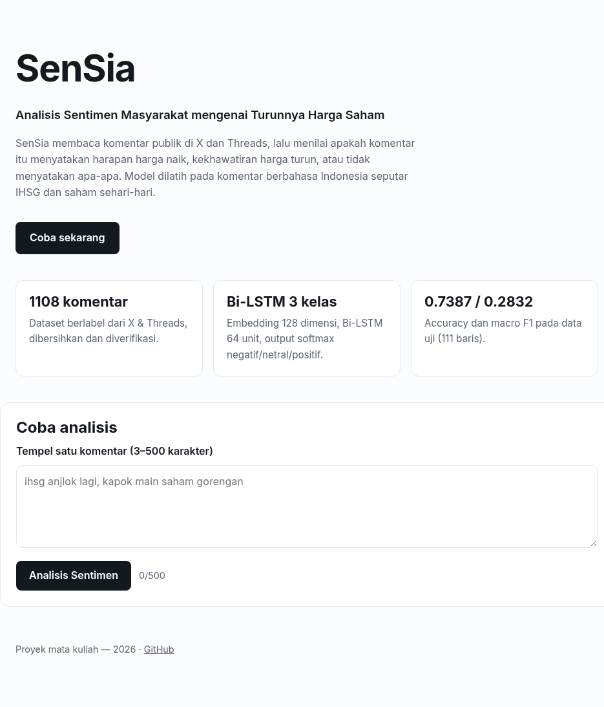
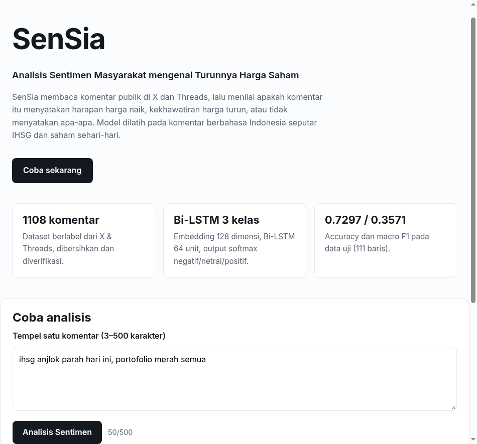

# SenSia

Analisis sentimen komentar publik (X dan Threads) tentang pergerakan saham Indonesia. Komentar diklasifikasikan ke tiga kelas — `negatif`, `netral`, `positif` — memakai model Bi-LSTM, lalu disajikan lewat satu halaman web Flask.

Proyek ini memisahkan **kontrak teks** ke dalam paket `sensia/`, sehingga notebook pelatihan dan web app memakai aturan cleaning yang sama. Tanpa itu, teks yang sama akan diperlakukan berbeda antara latihan dan prediksi, dan akurasi di laporan tidak berarti.

## Status saat ini (baca ini dulu)

Repo ini **belum** memenuhi target awal di dokumen desain. Yang sudah dan belum jadi, apa adanya:

| Hal | Target desain | Keadaan di repo |
|---|---|---|
| Sumber data | X + Threads | **Threads saja** — pencarian X memerlukan login dan belum dilakukan |
| Baris mentah | 1200 unik | **1.589** (1.465 lolos screening; 107 di antaranya transkripsi manual 35 screenshot di `data/screenshot/`) |
| Baris dataset | 900 berlabel (300/kelas) | **1.465** draft aturan (159 negatif / 1.085 netral / 221 positif), belum diverifikasi manusia |
| Verifikasi label | semua baris dibaca manusia + cek ulang 10% | **belum** — label masih draft berbasis aturan kata kunci |
| Test accuracy | ≥ 0.75 | **0.741** — praktis sama dengan baseline mayoritas kelas |
| Macro F1 | ≥ 0.70 | **0.285** |

Model dilatih pada 1.078 baris training dan masih condong ke kelas mayoritas: dari 135 baris uji, 100 diprediksi `netral`, satu `positif`, dan tidak satu pun `negatif`. Akurasi 0.741 tidak lebih baik dari baseline mayoritas, dan F1 kelas `negatif` 0.000. Menambah data tidak menolong karena labelnya belum diverifikasi — kelas `netral` menampung semua komentar yang tidak memuat kata kunci sentimen. Artefaknya di-commit supaya pipeline dan web app bisa dijalankan dan diuji, **bukan** sebagai model yang siap dipakai.

## Struktur folder

```
sensia/              kontrak data: label, konstanta, cleaning teks, validator dataset
tests/               pytest untuk preprocess, dataset, dan web app
data/raw/            CSV mentah hasil screening
data/labeled/        XLSX 5 kolom (text, platform, kata_kunci, tanggal, label)
model/               artefak terlatih: .keras, tokenizer.json, label_map.json
webapp/              Flask app, template, CSS, metrics.json
docs/                dokumen desain, rencana, panduan pelabelan
sensia_bilstm.ipynb  pipeline lengkap: muat data → latih → evaluasi → ekspor
```

## Setup

```bash
python -m venv .venv
source .venv/bin/activate
pip install -r requirements.txt
```

Python 3.11 atau 3.12 (TensorFlow belum mendukung 3.14). Tidak perlu GPU.

## Menjalankan test

```bash
python -m pytest -q
```

## Menghasilkan ulang model

Notebook memakai kernel dari `.venv`. Dari root repo:

```bash
jupyter nbconvert --to notebook --execute --inplace sensia_bilstm.ipynb
```

Atau buka `sensia_bilstm.ipynb` di VSCode dan jalankan semua cell. Proses ini menulis `model/sensia_bilstm.keras`, `model/tokenizer.json`, `model/label_map.json`, dan `webapp/metrics.json`.

## Menjalankan web app

```bash
python webapp/app.py
```

Buka `http://127.0.0.1:5000`. Halaman memuat metrik dari `webapp/metrics.json`, dan `POST /predict` menerima `{"text": "..."}` lalu mengembalikan `{"label", "confidence", "scores"}`. Teks di luar 3–500 karakter, atau teks yang setelah cleaning menjadi kosong (mis. hanya emoji), ditolak dengan `400 {"error": ...}`.

## Tangkapan layar





## Hasil latihan terakhir

Dari `webapp/metrics.json` (bukan angka yang diketik manual):

| Metrik | Nilai |
|---|---|
| Accuracy (test) | 0.741 |
| Macro F1 (test) | 0.285 |
| Baseline mayoritas kelas | 0.741 |
| Split train/val/test | 1.078 / 135 / 135 |

Per kelas pada 111 baris test:

| Kelas | Precision | Recall | F1 | Support |
|---|---|---|---|---|
| negatif | 0.000 | 0.000 | 0.000 | 15 |
| netral | 0.746 | 1.000 | 0.855 | 100 |
| positif | 0.000 | 0.000 | 0.000 | 20 |

`class_weight` seimbang sudah dicoba pada versi data sebelumnya (0.684 accuracy / 0.576 macro F1) dan tetap tidak melewati kedua ambang; nilainya tidak dipakai karena mengorbankan akurasi tanpa menyelesaikan penyebabnya. Penyebabnya ada di label, bukan di arsitektur: selama `netral` adalah tempat sampah untuk komentar tanpa kata kunci, model belajar satu kelas saja.

## Melanjutkan proyek ini

Urutannya penting — memperbaiki model sebelum memperbaiki data hanya menghasilkan overfit yang lebih rapi.

### Dua file data

| File | Isi | Untuk |
|---|---|---|
| `data/labeled/sensia_verifikasi.xlsx` | `label` kosong + `label_saran` | diisi manusia, mengikuti `docs/labeling-guide.md` |
| `data/labeled/sensia_labeled.xlsx` | `label` dari aturan kata kunci | dibaca notebook; **belum** diverifikasi |

Keduanya dibangun dari teks yang identik, jadi label yang sudah diperiksa bisa disalin langsung:

```bash
python scripts/prelabel.py            # workbook verifikasi (label kosong)
python scripts/prelabel.py --draft    # file latih dari label aturan
```

1. **Login ke X di browser yang dipakai pengambilan data**, lalu ambil kata kunci yang sama seperti di `docs/superpowers/plans/2026-11-20-sensia.md`. Tambahkan baris dengan `platform = x`.
2. **Verifikasi semua label** di `data/labeled/sensia_labeled.xlsx` mengikuti `docs/labeling-guide.md`, lalu simpan ulang 5 kolom final lewat `sensia.dataset.validate_labeled` + `dedupe_labeled`.
3. **Jalankan ulang notebook** (`Task 6 Step 4` di rencana menjelaskan urutan pemeriksaan bila ambang belum tercapai).
4. Baru setelah itu pertimbangkan `class_weight` atau hyperparameter.

## Keterbatasan

- Ini bukan prediksi harga saham, hanya klasifikasi arah sentimen teks.
- Dataset masih kecil, satu platform, dan labelnya belum diverifikasi manusia.
- Komentar diambil dari postingan publik; teks disimpan apa adanya tanpa username, handle, atau foto.
- Kalimat di luar gaya bahasa saham media sosial Indonesia kemungkinan salah diklasifikasi.
- Teks mentah dibersihkan dari artefak UI hasil pengambilan data (prefix tanggal `MM/DD/YY`, label `Translate`, garis miring penutup); isi komentar tidak diubah.
