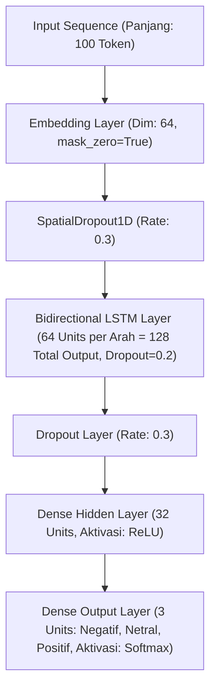

<div align="center">

# 📈 SenSia — Sentiment Analysis Saham Indonesia

**Sistem Analisis Sentimen Komentar Pasar Saham Indonesia Berbasis Deep Learning (Bi-LSTM) & Flask Web Application**

[](https://www.python.org/)
[](https://tensorflow.org/)
[](https://flask.palletsprojects.com/)
[](#informasi-pembuat)

[Tentang Proyek](#-tentang-proyek) • [Fitur Utama](#-fitur-utama) • [Teknologi](#-teknologi-yang-digunakan) • [Spesifikasi Model](#-spesifikasi-model--arsitektur) • [Cara Menjalankan](#-cara-menjalankan-proyek) • [Struktur Direktori](#-struktur-direktori) • [Tim Pengembang](#-informasi-pembuat)

---

</div>

## 📌 Tentang Proyek

**SenSia** (*Sentiment Analysis Saham Indonesia*) adalah proyek kecerdasan buatan (*Artificial Intelligence*) yang dirancang untuk mengklasifikasikan sentimen publik terhadap pergerakan saham, emiten, dan Indeks Harga Saham Gabungan (IHSG) ke dalam tiga kategori: **Negatif**, **Netral**, dan **Positif**.

Komentar media sosial seputar dunia pasar modal memiliki karakteristik yang sangat khas dan menantang, antara lain:
- Penggunaan istilah gaul finansial (*financial slang*) seperti *cuan*, *boncos*, *nyangkut*, *banting harga*, *guyur*, *merah*, dan *hijau*.
- Singkatan kata harian bahasa Indonesia (*gak*, *sdh*, *blm*, *dgn*, *pdhl*).
- Struktur kalimat informal, tanda baca berlebih, dan tautan/mention.

Untuk menjawab tantangan tersebut, **SenSia** mengintegrasikan *pipeline NLP (Natural Language Processing)* dengan kamus normalisasi *slang* khusus pasar saham, arsitektur *Deep Learning* **Bidirectional Long Short-Term Memory (Bi-LSTM)** menggunakan **TensorFlow/Keras**, serta antarmuka web interaktif berbasis **Flask** agar analisis sentimen dapat dilakukan secara instan (*real-time*).

Proyek ini disusun untuk memenuhi tugas akhir mata kuliah **Kecerdasan Buatan** pada program studi **Ilmu Komputer**, Fakultas Matematika dan Ilmu Pengetahuan Alam.

---

## ✨ Fitur Utama

- **Preprocessing & Slang Normalizer Khusus Saham**: Mengubah istilah pasar saham (*cuan* $\rightarrow$ untung, *boncos* $\rightarrow$ rugi, *nyangkut* $\rightarrow$ terjebak) dan singkatan umum menjadi bentuk baku.
- **Deep Learning Bi-LSTM Classifier**: Memanfaatkan pembacaan teks dua arah (maju dan mundur) untuk memahami konteks kalimat finansial secara utuh.
- **Interaktif & Real-time Web App**: Antarmuka modern yang menyajikan hasil prediksi, tingkat keyakinan (*confidence score*), visualisasi distribusi probabilitas ketiga kelas, dan metrik performa model.
- **RESTful API**: Endpoint `/predict` siap pakai dengan format pertukaran data JSON.
- **Reproducible Pipeline**: Notebook Jupyter komprehensif mulai dari Exploratory Data Analysis (EDA), perbandingan kandidat model (SimpleRNN vs LSTM vs Bi-LSTM), evaluasi metrik, hingga ekspor artefak model.

---

## 🛠️ Teknologi yang Digunakan

Proyek ini dibangun menggunakan ekosistem teknologi modern berbasis Python:

| Kategori | Teknologi / Pustaka | Kegunaan |
|---|---|---|
| **Deep Learning & NLP** | [TensorFlow](https://www.tensorflow.org/) / [Keras](https://keras.io/) | Perancangan arsitektur Embedding, Bi-LSTM, Dense, kompilasi & pelatihan model |
| **NLP Preprocessing** | `Keras Tokenizer`, RegEx, Custom Slang Normalizer | Pembersihan teks, konversi slang saham, tokenisasi sequence, padding |
| **Machine Learning & Evaluasi** | [Scikit-Learn](https://scikit-learn.org/) | *Stratified train-val-test split*, Confusion Matrix, Classification Report (F1, Precision, Recall) |
| **Data Manipulation & Analisis** | [Pandas](https://pandas.pydata.org/) & [NumPy](https://numpy.org/) | Eksplorasi data, manipulasi tabular, komputasi matriks/array |
| **Visualisasi Data** | [Matplotlib](https://matplotlib.org/) | Visualisasi distribusi kelas, histogram panjang teks, kurva loss & accuracy, bar chart |
| **Spreadsheet I/O** | [OpenPyXL](https://openpyxl.readthedocs.io/) | Pembacaan dataset terverifikasi dari format `.xlsx` |
| **Web Backend** | [Flask](https://flask.palletsprojects.com/) | Web server mikro & penyedia REST API inferensi model |
| **Frontend UI** | HTML5, CSS3, JavaScript (Fetch API) | Antarmuka pengguna modern yang responsif, minimalis, dan interaktif |
| **Notebook Environment** | [Jupyter Notebook](https://jupyter.org/) | Lingkungan eksperimentasi interaktif seluruh alur pelatihan |

---

## 🧠 Spesifikasi Model & Arsitektur

### 1. Dataset
- **Sumber Data**: `data/sensia_verifikasi2_berlabel.xlsx`
- **Total Sampel**: 1.465 baris data komentar terverifikasi.
- **Fitur**: `text`, `platform`, `kata_kunci`, `tanggal`, `label`.
- **Distribusi Kelas Sentimen**:
  - **Netral** : 502 data (34.27%)
  - **Positif** : 487 data (33.24%)
  - **Negatif** : 476 data (32.49%)
- **Pembagian Data (Stratified Split 80 : 10 : 10)**:
  - **Training Set (80%)**: 1.172 sampel
  - **Validation Set (10%)**: 146 sampel
  - **Testing Set (10%)**: 147 sampel

### 2. Pipeline Preprocessing Teks
1. **Case Folding**: Mengubah semua teks ke huruf kecil (*lowercase*).
2. **Noise Removal**: Menghapus URL/link web, mention `@user`, hashtag `#`, tanda baca, angka non-kontekstual, dan merapikan spasi berlebih.
3. **Slang & Jargon Stock Normalization**: Normalisasi kata tidak baku dan istilah bursa saham Indonesia menggunakan kamus terpetakan:
   - `cuan` $\rightarrow$ `untung`
   - `boncos` $\rightarrow$ `rugi`
   - `nyangkut` $\rightarrow$ `terjebak`
   - `banting` $\rightarrow$ `jual`
   - `hijau` $\rightarrow$ `naik`
   - `merah` $\rightarrow$ `turun`
   - *Serta singkatan umum: `gak`/`tdk` $\rightarrow$ `tidak`, `udah`/`sdh` $\rightarrow$ `sudah`, `blm` $\rightarrow$ `belum`, dll.*
4. **Tokenisasi & Padding**: Menggunakan Keras Tokenizer dengan batas kosakata maksimum `10.000` kata dan panjang token maksimal (`MAX_LEN`) `100` dengan *post-padding*.

### 3. Arsitektur Jaringan Neural (Bi-LSTM)

Model Bi-LSTM dipilih setelah melalui tahap perbandingan performa (*benchmark*) terhadap arsitektur **SimpleRNN** dan **LSTM Standar**.



#### Detail Konfigurasi Hyperparameter:
- **Optimizer**: Adam ($\text{learning rate} = 0.001$)
- **Loss Function**: `sparse_categorical_crossentropy`
- **Batch Size**: 32
- **Maksimum Epoch**: 25
- **Regularisasi & Callbacks**:
  - `EarlyStopping`: monitor `val_loss`, patience 4 epoch, `restore_best_weights=True`
  - `ReduceLROnPlateau`: monitor `val_loss`, factor 0.5, patience 2 epoch, minimum lr $1\times 10^{-5}$

---

## 📊 Hasil Evaluasi & Performa Model

Pengujian dilakukan pada **Data Uji (*Test Set*) sebanyak 147 data** yang belum pernah dilihat sama sekali oleh model selama proses pelatihan.

### Perbandingan Kandidat Model pada Data Validasi

| Model | Val Accuracy | Val Macro F1 | Val Loss | Status |
|---|:---:|:---:|:---:|:---:|
| **Bi-LSTM** | **61.64%** | **0.6133** | **0.9267** | ⭐ **Model Terpilih** |
| **LSTM Standar** | 50.00% | 0.4965 | 1.0453 | Alternatif |
| **SimpleRNN** | 45.21% | 0.4430 | 1.0827 | Pembanding Dasar |

### Hasil Pengujian pada Test Set (Bi-LSTM)

- **Test Accuracy**: **57.14%**
- **Test Macro F1-Score**: **57.19%**
- **Test Weighted F1-Score**: **57.19%**
- **Baseline Mayoritas**: **34.69%** (Kategori `netral`)
- **Peningkatan vs Baseline**: **+22.45%**

#### Classification Report Detail

| Kelas Sentimen | Precision | Recall | F1-Score | Support |
|:---|:---:|:---:|:---:|:---:|
| **Negatif** | 0.5283 (52.83%) | 0.5957 (59.57%) | 0.5600 | 47 |
| **Netral** | 0.5714 (57.14%) | 0.5490 (54.90%) | 0.5600 | 51 |
| **Positif** | 0.6222 (62.22%) | 0.5714 (57.14%) | 0.5957 | 49 |
| **Rata-rata Akurasi** | | | **0.5714 (57.14%)** | **147** |
| **Macro Average** | 0.5740 | 0.5721 | 0.5719 | 147 |
| **Weighted Average** | 0.5746 | 0.5714 | 0.5719 | 147 |

---

## 🚀 Cara Menjalankan Proyek

Ikuti langkah-langkah berikut untuk menjalankan proyek SenSia di komputer lokal:

### 1. Kloning Repositori
```bash
git clone https://github.com/username/sensia.git
cd sensia
```

### 2. Buat dan Aktifkan Virtual Environment (Disarankan)
- **Windows**:
  ```powershell
  python -m venv .venv
  .venv\Scripts\activate
  ```
- **macOS / Linux**:
  ```bash
  python3 -m venv .venv
  source .venv/bin/activate
  ```

### 3. Install Dependensi
Pastikan `pip` sudah diperbarui, lalu install seluruh pustaka yang tercantum di `requirements.txt`:
```bash
pip install -r requirements.txt
```

### 4. Menjalankan Aplikasi Web (Flask)
Aplikasi web siap dijalankan menggunakan model yang sudah diekspor di direktori `model/`:
```bash
cd webapp
python app.py
```
Setelah server menyala, buka peramban (*browser*) Anda dan akses:
```
http://127.0.0.1:5000/
```

### 5. Menjalankan / Melatih Ulang Model di Jupyter Notebook (Opsional)
Jika Anda ingin melihat proses pelatihan dari awal atau melatih kembali model:
```bash
jupyter notebook sensia_bilstm.ipynb
```
Jalankan seluruh sel (*Run All Cells*). Notebook akan otomatis mengekspor:
- `model/sensia_bilstm.keras`
- `model/tokenizer.json`
- `model/label_map.json`
- `webapp/metrics.json`

---

## 🔌 API Endpoint

Aplikasi web juga menyediakan REST API untuk integrasi ke sistem lain:

### `POST /predict`
Melakukan analisis sentimen pada satu teks komentar.

- **URL**: `http://127.0.0.1:5000/predict`
- **Method**: `POST`
- **Header**: `Content-Type: application/json`
- **Request Body**:
  ```json
  {
    "text": "IHSG hari ini naik kencang, portofolio langsung cuan luber!"
  }
  ```
- **Response Success (`200 OK`)**:
  ```json
  {
    "label": "positif",
    "confidence": 0.8842,
    "scores": {
      "negatif": 0.0412,
      "netral": 0.0746,
      "positif": 0.8842
    }
  }
  ```

---

## 📁 Struktur Direktori

```text
sensia/
├── data/
│   └── sensia_verifikasi2_berlabel.xlsx   # Dataset komentar saham berlabel (Excel)
├── model/
│   ├── label_map.json                     # Pemetaan index integer ke nama label (negatif, netral, positif)
│   ├── sensia_bilstm.keras                # Model terlatih Bi-LSTM dalam format native Keras v3
│   └── tokenizer.json                     # Kosakata & konfigurasi tokenisasi Keras
├── webapp/
│   ├── app.py                             # Backend Flask & controller prediksi inferensi
│   ├── index.html                         # Antarmuka web pengguna (HTML, CSS terintegrasi, JS)
│   └── metrics.json                       # Metrik evaluasi model (akurasi, F1, ukuran data)
├── referensi.jpeg                         # Tangkapan layar referensi antarmuka
├── requirements.txt                       # Daftar dependensi library Python
├── sensia_bilstm.ipynb                    # Notebook eksplorasi data, pelatihan, & evaluasi model
├── .gitignore                             # Daftar file yang diabaikan oleh Git
└── README.md                              # Dokumentasi resmi proyek
```

---

## 👥 Informasi Pembuat

Proyek ini dikembangkan oleh **Kelompok 4** — **Kelas Ilmu Komputer B** sebagai pemenuhan tugas proyek pada mata kuliah **Kecerdasan Buatan**:

| Nama Lengkap | NIM | Peran / Kontribusi |
|---|:---:|---|
| **Muhammad Hidayat** | `F1G125043` | Arsitektur Deep Learning (Bi-LSTM), Web Backend Flask, Integrasi Model |
| **Ranti Kurniasih** | `F1G125048` | Pengolahan Data & EDA, Data Preprocessing, Normalisasi Slang |
| **Kallyn Renanda Putri** | `F1G125035` | Desain Antarmuka Web (UI/UX), Evaluasi Metrik & Pengujian Prediksi |

### Dosen Pengampu:
**Bapak Ilham Julian Effendi, S.T., M.T.**  
Mata Kuliah: **Kecerdasan Buatan**  
Program Studi: **Ilmu Komputer (Kelas B)**  

---

<div align="center">
  <sub>Dibuat dengan ❤️ oleh Kelompok 4 Ilmu Komputer B • Universitas Halu Oleo</sub>
</div>
